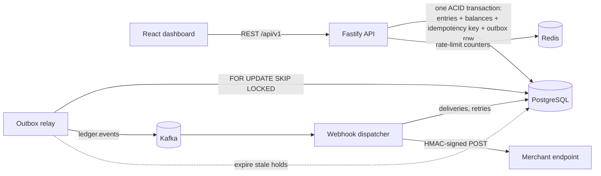

# Ledgerly

[](https://github.com/Harisankar2000/ledgerly/actions/workflows/ci.yml)


A **double-entry payment ledger and wallet service** with a React dashboard. It covers what sits underneath a wallet product such as Paytm, PhonePe or Razorpay:

- wallets, top-ups, payouts and peer-to-peer transfers
- card-style **holds** (authorise, capture, release, auto-expire)
- full and partial **refunds**
- **idempotent** money APIs
- events published through a **transactional outbox to Kafka**
- **HMAC-signed webhooks** with retries
- **reconciliation** reports that prove the books balance

**Stack:** TypeScript · Node.js 22 · Fastify 5 · PostgreSQL 17 (raw SQL with `pg`) · Kafka · Redis · React 19 + Vite + TanStack Query + Tailwind · Docker · Vitest · GitHub Actions

---

## Why it is interesting

Moving money correctly is a concurrency problem. Each guarantee below is enforced in code **and** proven by an integration test against a real database:

| Guarantee                                        | How                                                                                                                                                                 | Test                                                             |
| ------------------------------------------------ | ------------------------------------------------------------------------------------------------------------------------------------------------------------------- | ---------------------------------------------------------------- |
| Money is never created or destroyed              | Every movement is a set of journal entries that **sum to zero**, enforced by a `DEFERRABLE` constraint trigger at `COMMIT`                                          | `rejects an unbalanced journal at COMMIT`                        |
| No overdraft under concurrency                   | Accounts are locked with `SELECT … FOR UPDATE`, and a `CHECK (balance >= 0)` constraint is the last line of defence                                                 | 50 concurrent transfers race for one balance: exactly 10 succeed |
| No deadlocks                                     | Rows are always locked in **sorted id order**; deadlock and serialization errors are retried with jittered backoff                                                  | A→B and B→A transfers fired simultaneously                       |
| No double charges                                | The `Idempotency-Key` is stored **in the same DB transaction** as the payment; a concurrent duplicate waits on the primary key and then replays the stored response | 10 identical requests in parallel produce 1 transaction          |
| Refunds never exceed the payment                 | The original transaction row is locked; a `CHECK (refunded_amount <= amount)` constraint backs it up                                                                | 8 concurrent partial refunds: only 3 fit                         |
| Immutable audit trail                            | `entries` is append-only (an UPDATE/DELETE trigger raises); corrections are new transactions                                                                        | `keeps entries append-only`                                      |
| No lost or phantom events                        | Events are written to an **outbox table in the same transaction**; a relay publishes them to Kafka with `FOR UPDATE SKIP LOCKED`                                    | Kafka down: events stay unpublished, nothing is lost             |
| Webhooks are delivered exactly once per endpoint | Consumer de-duplicates on `(endpoint_id, event_id)`; deliveries retry with exponential backoff, using a lease rather than long-held locks                           | redelivered Kafka message produces 1 delivery                    |

## Architecture



Three processes share one codebase:

| Process      | Role                                                                                     |
| ------------ | ---------------------------------------------------------------------------------------- |
| `api`        | REST API. Serves the dashboard; runs migrations on start, guarded by an advisory lock    |
| `relay`      | Publishes the outbox to Kafka and releases expired holds                                 |
| `dispatcher` | Kafka consumer group: fans events out to webhook endpoints and retries failed deliveries |

### The ledger model

Every account has a balance in **integer minor units** (paise or cents; floats never touch money). A transaction is a list of signed legs that sum to zero:

```text
Transfer ₹250 Asha → Rahul            Hold ₹600 on Rahul            Capture ₹420 to Chai Point
  Asha            −25000                Rahul           −60000        Hold suspense    −42000
  Rahul           +25000                Hold suspense   +60000        Chai Point       +42000
                  ──────                                ──────        (₹180 remainder released to Rahul)
                       0                                     0
```

The system accounts are the other side of every entry:

- `settlement:INR` is the outside world. Top-ups debit it, so it goes negative by design.
- `holds:INR` is suspense for authorised funds.

All of the money-moving code goes through **one function**, `postJournal()`. It does the locking, validation, entries, balances and the outbox event, so a new operation only has to describe its legs.

### Reconciliation

`POST /reconciliation/runs` runs independent SQL checks in one `REPEATABLE READ` snapshot:

1. Each transaction's entries sum to zero.
2. Each cached balance equals the sum of that account's entries.
3. All balances in a currency sum to zero.
4. The hold suspense balance equals the total of active holds.
5. Each transaction's refunded amount equals the sum of its refunds.

It also reports the outbox lag. Tamper with a balance in SQL and the report flags it (this case is tested).

## Quick start

Requires Docker.

```bash
cp .env.example .env
docker compose up -d --build        # postgres, redis, kafka, api, relay, dispatcher, webhook-sink, web
docker compose exec -e SEED_WEBHOOK_URL=http://webhook-sink:4000/webhooks api node dist/dev/seed.js
```

| URL                        | What                                                                                    |
| -------------------------- | --------------------------------------------------------------------------------------- |
| http://localhost:8081      | React dashboard                                                                         |
| http://localhost:3001/docs | Swagger UI (API key: `dev-ledger-key`)                                                  |
| http://localhost:4000      | Demo webhook receiver: recent events (fails 20% of requests on purpose to show retries) |

### Local development

```bash
npm ci
docker compose up -d postgres redis kafka webhook-sink
npm run migrate -w apps/api && npm run seed -w apps/api
npm run dev:api                                   # :3001
npm run dev:web                                   # :5173, proxies /api to :3001
npm run dev:relay -w apps/api                     # optional: outbox → Kafka
npm run dev:dispatcher -w apps/api                # optional: Kafka → webhooks
```

## API

Base path `/api/v1`. All requests need the `x-api-key` header. Money-moving `POST`s need an `Idempotency-Key`; replayed responses carry `Idempotent-Replayed: true`.

| Method                | Path                                                            | Description                                   |
| --------------------- | --------------------------------------------------------------- | --------------------------------------------- |
| `POST`                | `/accounts`                                                     | Create a wallet                               |
| `GET`                 | `/accounts`, `/accounts/:id`                                    | List and get accounts with balances           |
| `GET`                 | `/accounts/:id/entries`                                         | Statement: entries with running balance       |
| `PATCH`               | `/accounts/:id/status`                                          | Freeze or unfreeze                            |
| `POST`                | `/deposits`, `/withdrawals`                                     | Top up or pay out via the settlement account  |
| `POST`                | `/transfers`                                                    | Wallet-to-wallet transfer                     |
| `POST`                | `/transactions/:id/refunds`                                     | Full or partial refund                        |
| `GET`                 | `/transactions`, `/transactions/:id`                            | List; detail with journal entries and refunds |
| `POST`                | `/holds`, `/holds/:id/capture`, `/holds/:id/release`            | Authorise, capture (partial OK) and release   |
| `GET`                 | `/holds`                                                        | List holds                                    |
| `POST`/`GET`/`DELETE` | `/webhook-endpoints`                                            | Manage endpoints (the secret is shown once)   |
| `GET`                 | `/webhook-deliveries`, `POST /webhook-deliveries/:id/redeliver` | Delivery log and manual redelivery            |
| `POST`/`GET`          | `/reconciliation/runs`                                          | Run and list integrity reports                |
| `GET`                 | `/overview`                                                     | Dashboard numbers                             |

Example:

```bash
curl -X POST localhost:3001/api/v1/transfers \
  -H 'x-api-key: dev-ledger-key' -H 'content-type: application/json' \
  -H 'idempotency-key: order-1042-payment' \
  -d '{"sourceAccountId":"…","destinationAccountId":"…","amount":25000,"description":"Dinner split"}'
```

Errors are consistent and machine-readable:

```json
{
  "error": {
    "code": "INSUFFICIENT_FUNDS",
    "message": "…",
    "details": { "available": 1000, "required": 1001 },
    "requestId": "…"
  }
}
```

### Verifying webhooks

Every delivery carries `ledgerly-signature: t=<unix>,v1=<hex>`, where `v1 = HMAC_SHA256(secret, "<t>.<raw body>")`. Reject a request if the signature doesn't match or `t` is more than 5 minutes old. See `verifySignature()` in `apps/api/src/workers/webhook-signature.ts`.

## Testing

```bash
npm test                     # unit tests
docker compose up -d postgres redis kafka
npm run test:integration     # 27 tests against real Postgres, Redis and Kafka (uses a separate ledgerly_test database)
```

## Project structure

```text
apps/
├── api/src/
│   ├── db/            # pg pool, transaction helper with deadlock retry, SQL migrations + runner
│   ├── ledger/        # Core: postJournal(), idempotency, outbox
│   ├── modules/       # accounts · transactions · holds · webhooks · reconciliation  (routes → service → repository)
│   ├── workers/       # outbox relay, webhook dispatcher, signatures, poller
│   ├── kafka/         # client, topic setup, publisher
│   ├── http/          # Fastify app, auth, error handling, Swagger
│   ├── server.ts · relay.ts · dispatcher.ts
│   └── dev/           # seed script, demo webhook receiver
└── web/src/
    ├── api/           # fetch client, types, TanStack Query hooks
    ├── components/    # UI kit, layout, money dialogs (one Idempotency-Key per dialog)
    └── pages/         # Dashboard, Wallets, Transactions, Holds, Webhooks, Reconciliation
```

## Trade-offs and next steps

- **Hot system accounts:** every top-up locks `settlement:INR`. At high volume, shard it into N sub-accounts or stop maintaining a cached balance for it.
- **Outbox ordering:** a single relay preserves order per aggregate. Several relays trade strict ordering for throughput, which is acceptable because consumers are idempotent.
- **Webhook SSRF:** production should block private IP ranges for endpoint URLs.
- **Next:** multi-currency FX transfers, scheduled payouts, a statement PDF export, and OpenTelemetry tracing across API, Kafka and the dispatcher.

## License

MIT © Harisankar Sahoo
